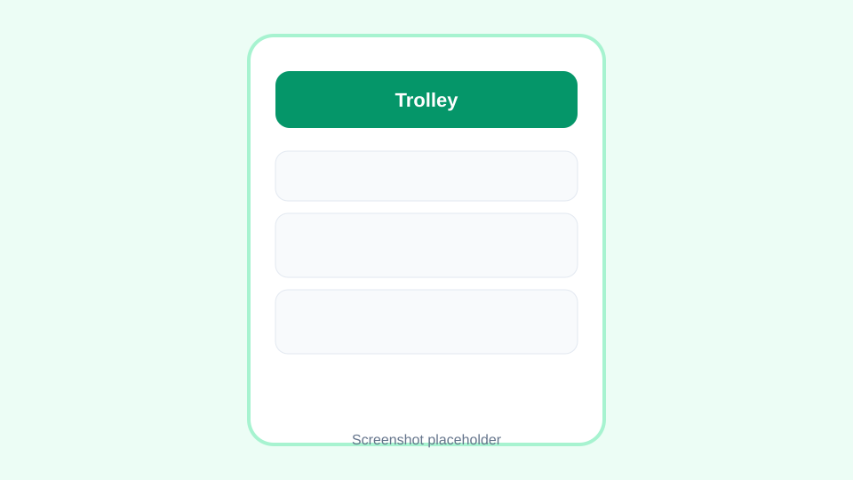

# Trolley

A shared grocery list I built so my friends and I can edit the same list live while someone is already in the shop.

It works as a phone-friendly PWA, groups items by aisle category, and shows who added or bought each thing. You can try it with zero setup in demo mode, then plug in Supabase when you want real accounts and sync across devices.



## Features

- Create, rename, and delete shared lists
- Add items with quantity, optional note, and category
- Tick items off with big tap targets for shopping
- Live updates for everyone on the list
- Invite friends with a link
- Demo mode that stores data in your browser (no backend needed)
- Optional Supabase backend with magic link auth, Postgres, RLS, and Realtime

## Stack

- Vite + React + TypeScript
- Tailwind CSS
- Supabase JS (auth, Postgres, Realtime) or localStorage demo backend
- Vitest + React Testing Library
- ESLint + Prettier
- GitHub Actions CI
- PWA via `vite-plugin-pwa`

## Run in demo mode

```bash
npm install
npm run dev
```

Open the URL Vite prints. No `.env` file needed. Data stays in `localStorage` and syncs across tabs on the same browser.

Useful scripts:

```bash
npm run lint
npm run typecheck
npm test
npm run build
```

## Set up Supabase (optional)

1. Create a free project at [supabase.com](https://supabase.com).
2. In the SQL editor, paste and run `supabase/migrations/0001_init.sql`.
3. Enable Email auth under Authentication > Providers (magic link).
4. Copy Project URL and anon public key from Project Settings > API.
5. Create a `.env` file:

```bash
cp .env.example .env
```

```env
VITE_SUPABASE_URL=https://YOUR_PROJECT.supabase.co
VITE_SUPABASE_ANON_KEY=YOUR_ANON_KEY
```

6. Restart `npm run dev`. The app switches to Supabase automatically when both values are set.

Add your production URL to Supabase Auth > URL configuration so magic links redirect correctly.

## Deploy to Vercel

1. Push this repo to GitHub.
2. Import the project in Vercel.
3. Set `VITE_SUPABASE_URL` and `VITE_SUPABASE_ANON_KEY` in Vercel env vars (or leave them empty for demo mode).
4. Deploy. The included `vercel.json` rewrites routes to `index.html` for the SPA.

## Roadmap

- Receipt cost splitting after a shop
- One-tap "usuals" for items you buy every week
- Push notifications when a friend adds something

## License

MIT. Copyright (c) 2026 Adison Ng.
